# RNA-seq Differential Expression: E. coli K-12 under Kanamycin Stress

A complete RNA-seq differential expression pipeline in R/Bioconductor, from raw count tables to annotated DEG lists and functional enrichment. Built as a portfolio project demonstrating an end to end transcriptomics workflow.

## Overview

This project re-analyzes public RNA-seq data to characterize the transcriptional response of *Escherichia coli* K-12 MG1655 to kanamycin, an aminoglycoside antibiotic. The pipeline covers metadata inspection, count-matrix QC, DESeq2 normalization and modeling, sample QC plots, differential expression testing, gene annotation, and GO/KEGG enrichment analysis. Every number reported below comes from running `rnaseq_deseq2_analysis.R` on this data.

## Dataset

- Source: GEO accession **GSE220559** (per-sample read-count tables from the series supplementary files)
- Organism: *Escherichia coli* K-12 MG1655
- Design: **kanamycin-treated vs water control**, 3 biological replicates each (6 samples total)
- Samples: GSM6806878, GSM6806879, GSM6806880 (kanamycin); GSM6806890, GSM6806891, GSM6806892 (water)
- Reference: Bie et al. 2023, *Microbiology Spectrum*, doi:10.1128/spectrum.00317-23

## Methods

1. Count tables merged into a 4,498 gene x 6 sample matrix (b-number locus tags); sample columns matched to metadata and low-count genes filtered (rowSums >= 10, 4,317 genes retained).
2. `DESeqDataSet` with design `~ treatment`; size-factor normalization; variance-stabilizing transformation (VST).
3. QC: library sizes, count distributions (raw vs normalized), PCA, hierarchical clustering dendrogram, sample distance and correlation heatmaps.
4. Differential expression with `DESeq`, contrast kanamycin vs water; significance at Benjamini-Hochberg adjusted p < 0.05.
5. Annotation: b-number to Entrez ID and gene symbol via a bundled mapping built from KEGG and org.EcK12.eg.db.
6. Enrichment: GO (BP, CC, MF) with clusterProfiler and org.EcK12.eg.db; KEGG pathways with clusterProfiler (organism `eco`).

## Results summary

- Genes tested: **4,317**; significant DEGs (padj < 0.05): **3,554** (82.3% of tested genes)
- Upregulated in kanamycin: **1,863**; downregulated: **1,691**
- Top upregulated gene: **tisB** (b4618), log2FC 4.81, padj 2.4e-268 (SOS stress response gene)
- Top downregulated gene: **ybaT** (b0486), log2FC -5.64
- GO enrichment: 6 significant Molecular Function terms, including **ATP hydrolysis activity** (GO:0016887), **hydrolase activity acting on acid anhydrides** (GO:0016817), and **ATP-dependent activity** (GO:0140657); no BP or CC terms passed p.adjust < 0.05. Note: with 82% of genes differentially expressed, enrichment signal is diluted genome-wide, so only the strongest functional signals survive correction.
- KEGG enrichment: 2 significant pathways, **Carbon metabolism** (eco01200, 102 genes) and **Biosynthesis of secondary metabolites** (eco01110, 311 genes).

## Figures

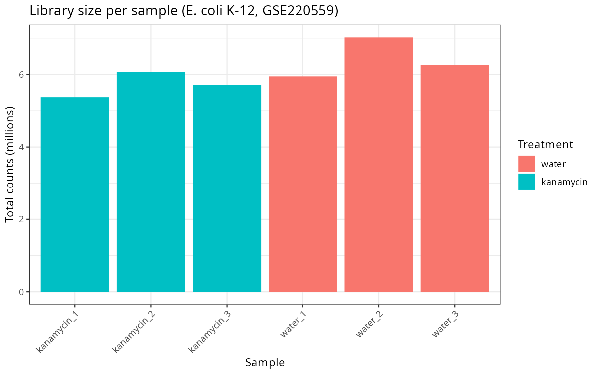
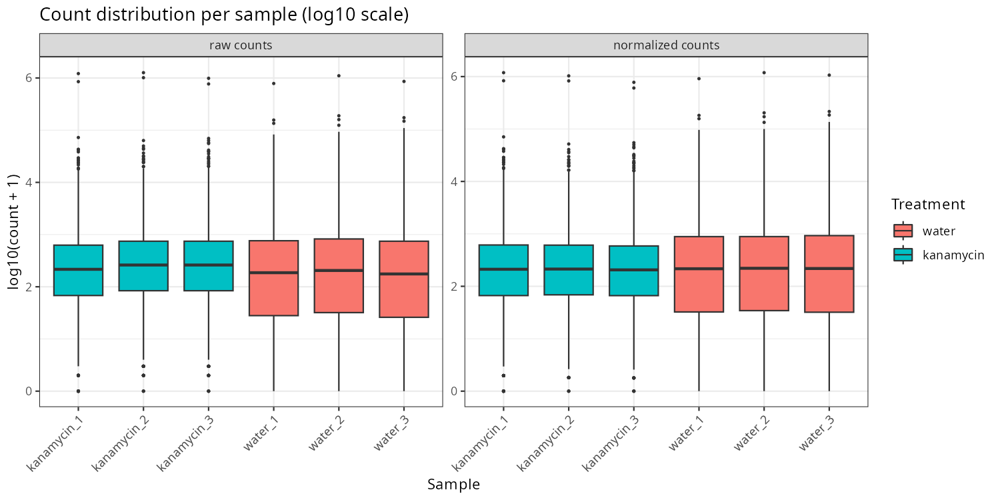
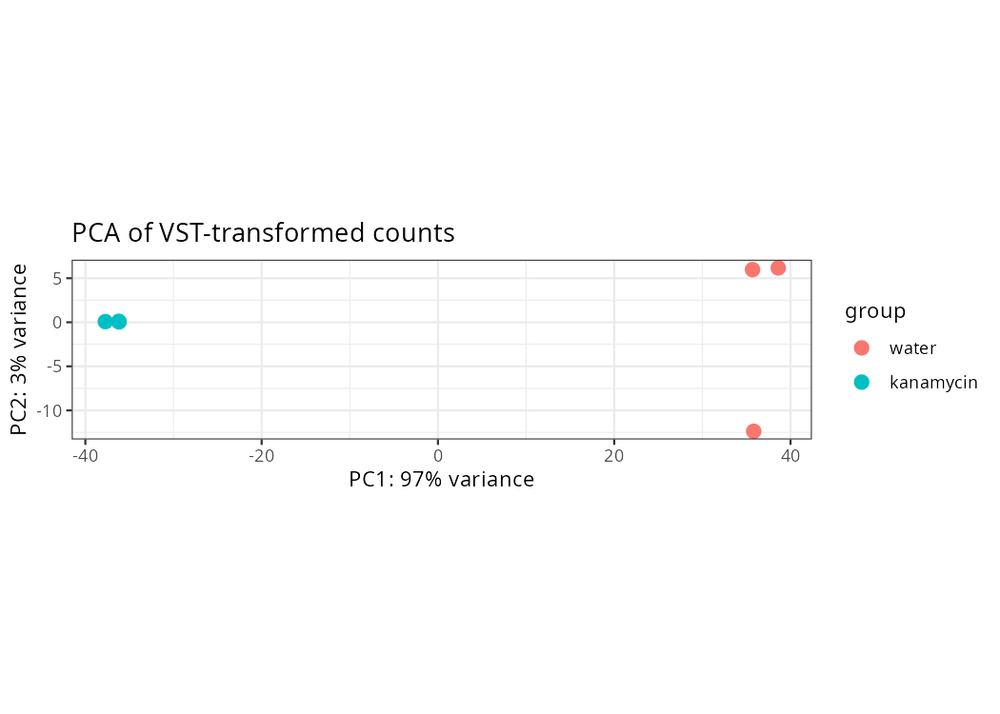
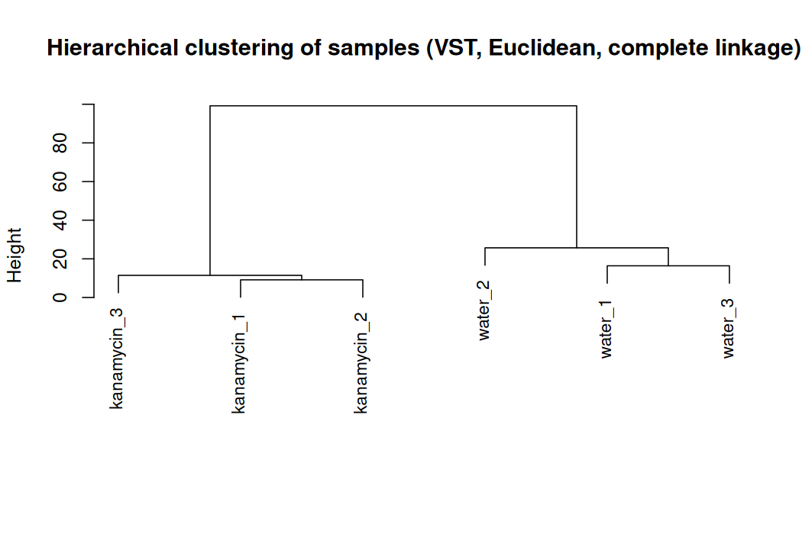
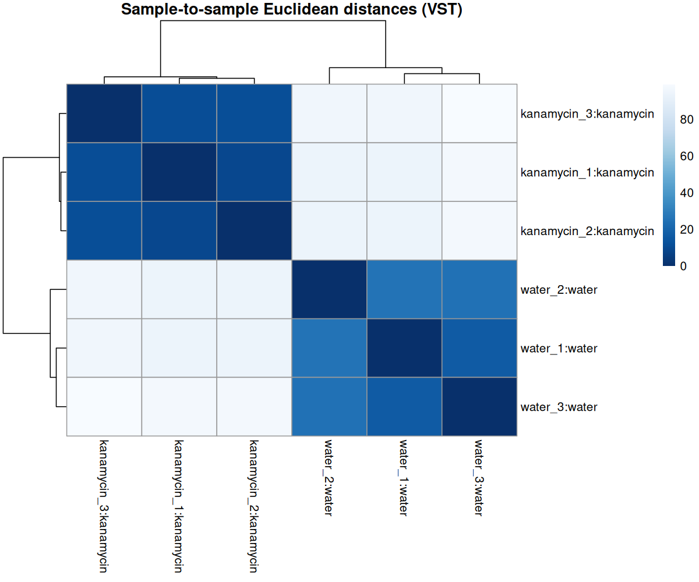
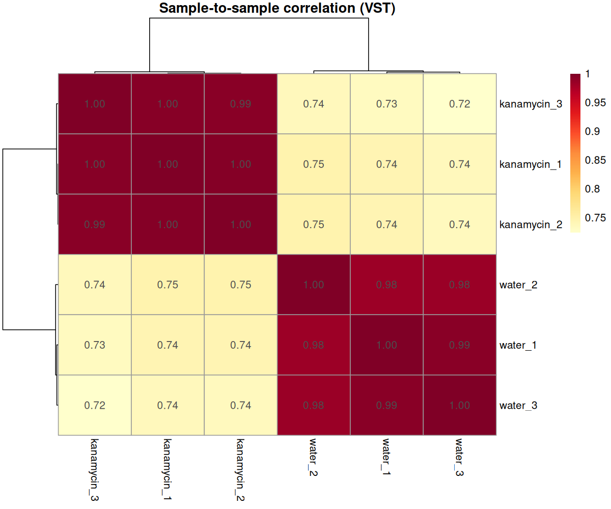
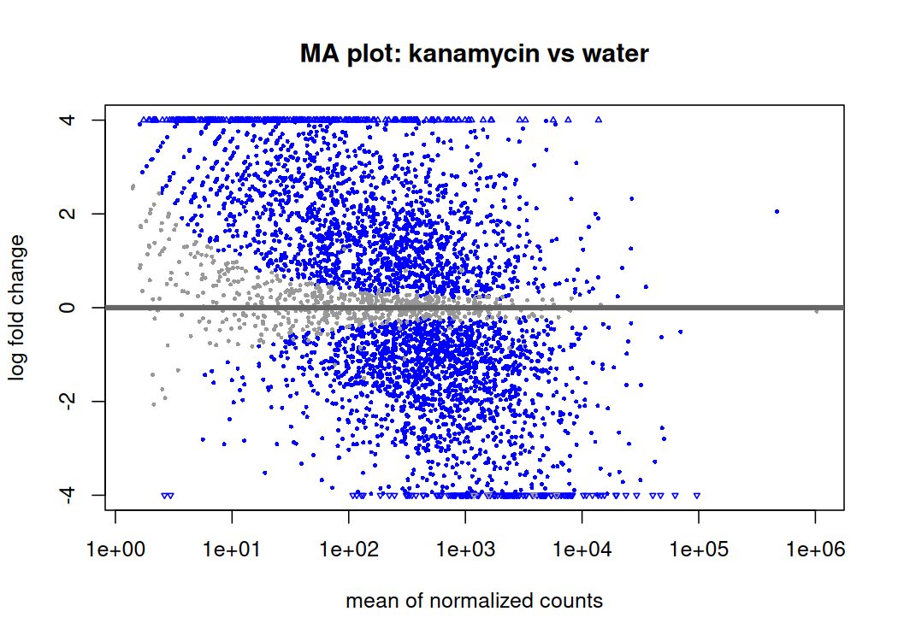
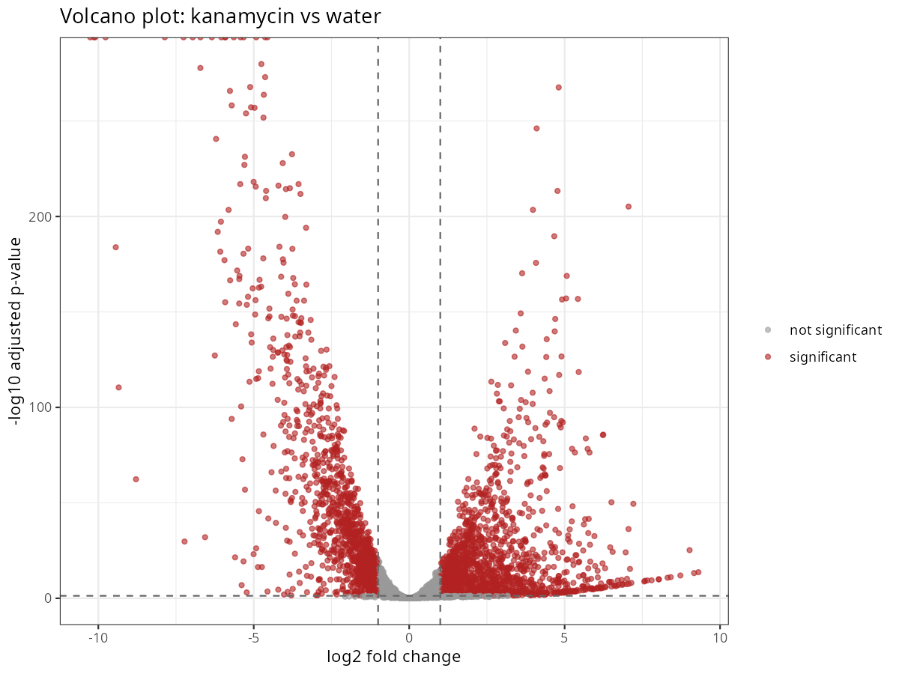
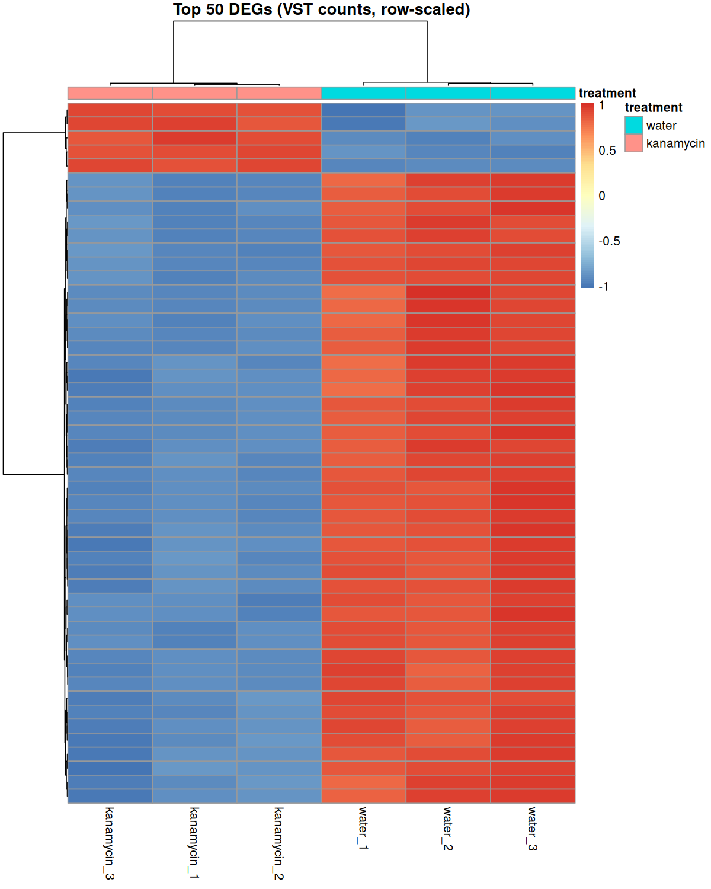
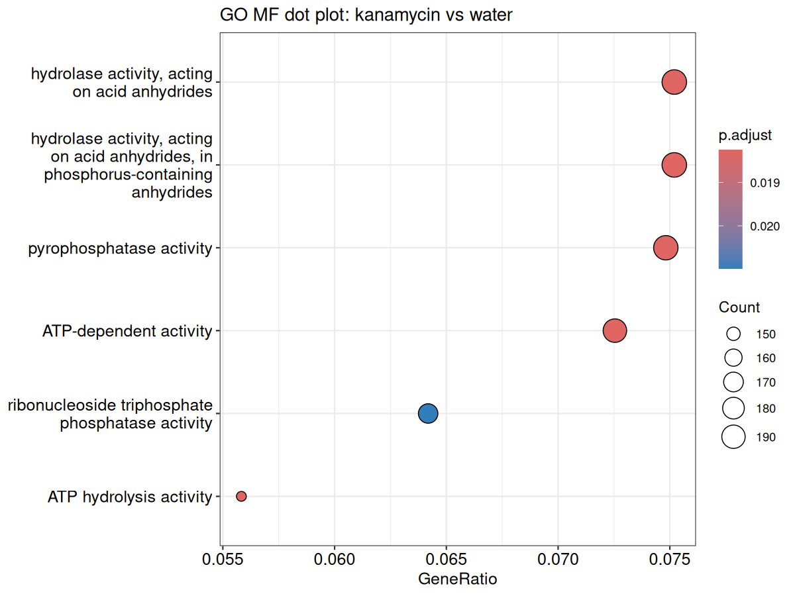
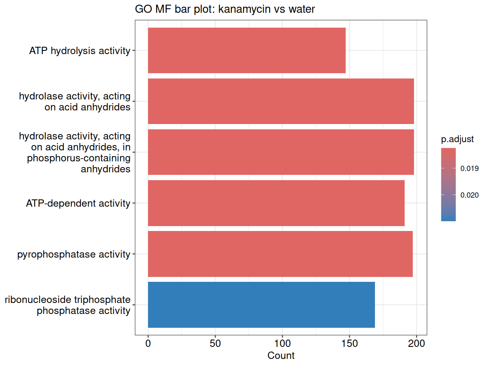
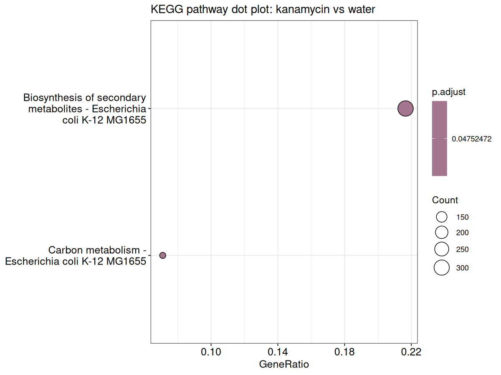
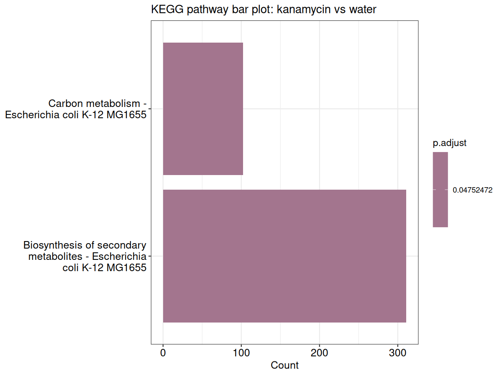

## Requirements

- R >= 4.3 with Bioconductor 3.18
- R packages: DESeq2, clusterProfiler, org.EcK12.eg.db, enrichplot, pheatmap, RColorBrewer, ggplot2, KEGGREST
- Internet access for KEGG pathway queries (enrichment step only)

Install the Bioconductor packages with:

```r
if (!requireNamespace("BiocManager", quietly = TRUE))
    install.packages("BiocManager")
BiocManager::install(c("DESeq2", "clusterProfiler", "org.EcK12.eg.db",
                       "enrichplot", "pheatmap", "KEGGREST"))
install.packages(c("RColorBrewer", "ggplot2"))
```

## How to run

From the repository root:

```bash
Rscript rnaseq_deseq2_analysis.R
```

Plots are written to `figures/` and tables to `results/`.

## Repository layout

```text
ecoli-rnaseq-deseq2-antibiotic-stress/
├── rnaseq_deseq2_analysis.R     # the full pipeline, commented by section
├── data/                     # GEO count tables + gene annotation map
├── figures/                  # QC and DEG plots (PNG)
├── results/                  # DEG tables, enrichment tables, session info
└── README.md
```

## Data note

Count tables are the per-sample supplementary files deposited with GSE220559 at GEO and are redistributed here for reproducibility. No raw sequencing reads are bundled. `data/ecoli_k12_gene_annotation.csv` maps b-number locus tags to Entrez IDs and gene symbols.

## Reference

Bie L, Zhang M, Wang J, et al. Comparative Analysis of Transcriptomic Response of *Escherichia coli* K-12 MG1655 to Nine Representative Classes of Antibiotics. *Microbiol Spectr*. 2023;11(2):e00317-23. doi:10.1128/spectrum.00317-23
